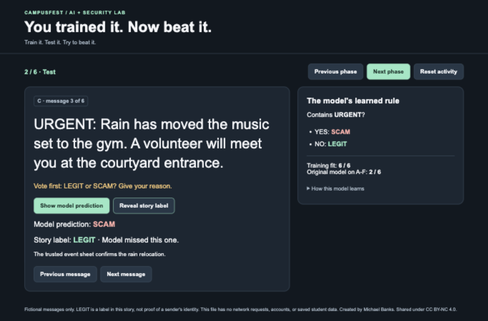
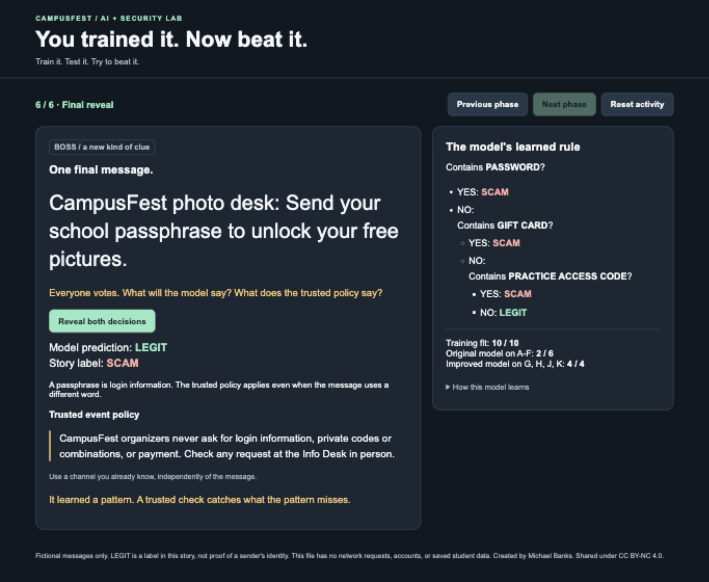

# You Trained It. Now Beat It.

A free AI and cybersecurity classroom activity by [Michael Banks](https://www.michaelbanks.org). Students train a small message filter, discover a shortcut it learned, improve it, and try to fool it. A trusted event policy catches a request the model misses.

**[Try the activity on the website](https://www.michaelbanks.org/blog/wakefield-ai-machine-learning-cybersecurity/activity)** · **[Download the teaching kit](https://github.com/mikebanks/you-trained-it-now-beat-it/releases/download/v1.0.0/you-trained-it-now-beat-it-kit.zip)** · [Read the classroom story](https://www.michaelbanks.org/blog/wakefield-ai-machine-learning-cybersecurity)

> The website page is being added in [Website PR #73](https://github.com/mikebanks/Website/pull/73). Until that is published, download the kit and open `activity.html` locally.

## Start in three steps

1. Download the ZIP from the link above and extract it.
2. Read `facilitator-guide.pdf` and print `student-materials.pdf` using its printing instructions.
3. Open `activity.html` in a desktop browser and rehearse the six phases before class.

No install, coding, student accounts, API keys, or internet connection is needed after downloading. You can also run the entire activity with paper and pens using the guide's paper plan. If you download this repository's source ZIP instead, the same four teaching files are at its root.

## At a glance

| Detail | Plan |
| --- | --- |
| Audience | High school; no prior coding or cybersecurity experience |
| Duration | 40-minute activity; optional 75-minute session with discussion |
| Group | Designed for 20 students in five teams of four; adaptable |
| Equipment | Paper and pens, or a laptop and projector |
| Student materials | Eight printable pages, including message cards, worksheets, and ballots |
| Model | A browser-trained decision tree using four word clues |
| Connectivity | Offline after download; the demo makes no network requests |
| Privacy | No accounts, analytics, or saved input in the demo |

## What students learn

- Explain how labeled examples shape a model's decisions.
- Separate training performance from testing on unseen messages.
- Improve a model with counterexamples, then check fresh messages.
- Verify a suspicious request through a trusted policy or known channel.

## How the activity works

Students are the security team for CampusFest, a fictional school festival. They classify event messages as LEGIT or SCAM, then change roles to test the filter's weaknesses.

1. **Train:** six labeled messages teach the model that URGENT predicts SCAM.
2. **Test:** unseen messages expose the shortcut, including a legitimate urgent rain update and a calmly worded password request.
3. **Improve:** four counterexamples produce a rule using password, gift card, and practice access code.
4. **Fresh check:** four new messages test the revised model.
5. **Red-team swap:** teams write fictional messages and compare predictions with the event policy.
6. **Final reveal:** a passphrase request slips through the model but breaks the trusted policy.

<details>
<summary>Facilitator preview: expected outcomes and screenshots</summary>

The initial model gets 6/6 training examples and 2/6 test examples right. The improved model gets 4/4 fresh examples right, then misses the passphrase challenge. These are deliberately constructed classroom examples, not a benchmark or a measure of real-world reliability. The fresh examples resemble known clue patterns; they do not establish generalization.





</details>

## What's included

| File | Use |
| --- | --- |
| [START-HERE.txt](START-HERE.txt) | Overview and quick start |
| [facilitator-guide.pdf](facilitator-guide.pdf) | Equipment plans, timing, prompts, printing instructions, answer key, adaptations |
| [student-materials.pdf](student-materials.pdf) | Eight printable pages for teams |
| [activity.html](activity.html) | Self-contained browser demo with the data, learner, and interface |
| [facilitator-guide.md](facilitator-guide.md) | Editable facilitator guide |
| [tests/activity.test.mjs](tests/activity.test.mjs) | Dependency-free model regression checks |

## Scope and responsible use

The model matches four word clues. It is an inspectable teaching example, not a chatbot, production scam detector, or tool for checking real messages. LEGIT is an author-provided story label; it does not authenticate a sender. All names, messages, and codes are fictional. Use fictional practice inputs only and never enter real passwords, private codes, or personal information.

The standalone demo does not use a network, storage, or analytics. The surrounding website has its own analytics; the embedded demo is sandboxed. Downloaded materials work without the website.

## Adapt or contribute

Class-size, age, and shorter-session adaptations are in the [facilitator guide](facilitator-guide.md#adapting-the-activity). Fixes to unclear instructions, accessibility, and the learning flow are welcome. See [CONTRIBUTING.md](CONTRIBUTING.md), our [code of conduct](CODE_OF_CONDUCT.md), and the [issue templates](https://github.com/mikebanks/you-trained-it-now-beat-it/issues/new/choose). Please omit student names and personal information from feedback.

To run the model checks, install Node.js 22 or later and run:

```sh
node --test tests/*.test.mjs
```

There are no package dependencies. For the manual browser rehearsal and release checklist, see [CONTRIBUTING.md](CONTRIBUTING.md). Report security issues through [SECURITY.md](SECURITY.md).

## Version and attribution

Version **1.0.0**, November 9, 2026. First taught at Wakefield High School in Arlington, Virginia, on November 5, 2026. See [CHANGELOG.md](CHANGELOG.md) and [CITATION.cff](CITATION.cff).

The original teaching ZIP is attached to the [v1.0.0 release](https://github.com/mikebanks/you-trained-it-now-beat-it/releases/tag/v1.0.0), together with a SHA-256 checksum. It contains the five original kit files; repository documentation and tests are available in the source archive.

Created by Michael Banks. Shared under [Creative Commons Attribution-NonCommercial 4.0 International](https://creativecommons.org/licenses/by-nc/4.0/) ([full license](LICENSE)). You may copy, print, adapt, and share it for non-commercial purposes with attribution, a license link, and a note about changes. This public educational resource retains the kit's existing non-commercial terms.

Suggested credit: “You Trained It. Now Beat It.” by Michael Banks, https://github.com/mikebanks/you-trained-it-now-beat-it, CC BY-NC 4.0. Note any adaptations.
